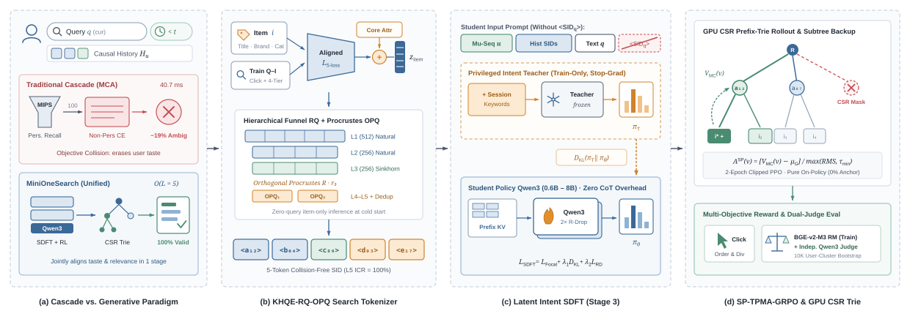
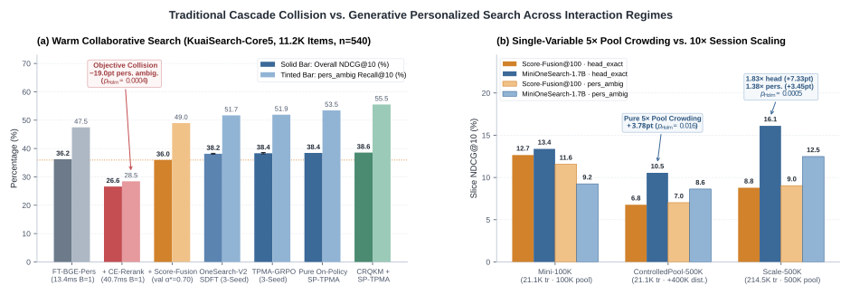
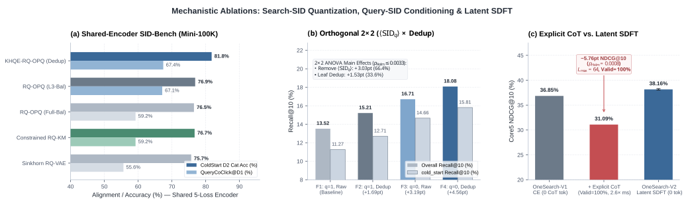
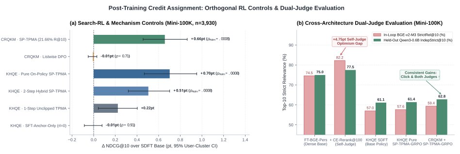
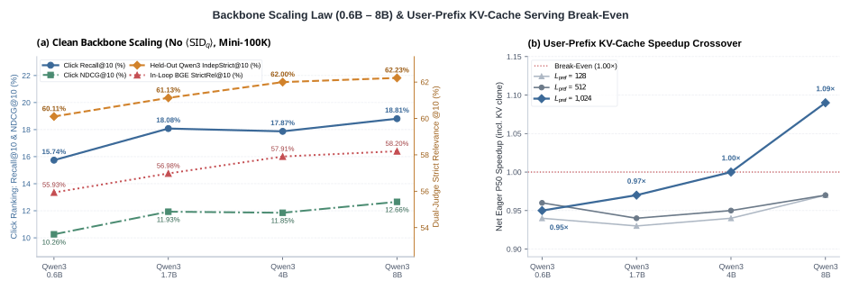

<div align="center">

# MiniOneSearch

**An Open Benchmark, Mechanistic Ablation & Post-Training Suite for End-to-End Generative Personalized Search**

[](./pyproject.toml)
[](./pyproject.toml)
[%20%26%20V2%20(NeurIPS'26)-222A35?style=flat-square)](#citation--acknowledgements)
[](./docs/BENCHMARK_RESULTS.md)
[](https://huggingface.co/datasets/benchen4395/KuaiSearch)

[**Overview**](#overview--design) · [**Key Empirical Findings**](#key-empirical-findings) · [**Benchmark Suite**](#four-regime-benchmark-suite) · [**Quickstart**](#quickstart) · [**Full 72-Run Tables & CIs**](./docs/BENCHMARK_RESULTS.md)

</div>

<p align="center">
  
  <br/>
  <sub><b>Figure 1.</b> Overview of <b>MiniOneSearch</b>: <b>(a)</b> Traditional multi-stage cascade vs. unified <i>O(L = 5)</i> constrained generative search; <b>(b)</b> 5-Loss KHQE-RQ-OPQ Tokenizer with L1/L2 natural clustering, L3 Sinkhorn balancing, and item-only cold-start inference; <b>(c)</b> Privileged-teacher Latent Intent SDFT without &lt;SID<sub>q</sub>&gt; conditioning or CoT token overhead; <b>(d)</b> On-policy SP-TPMA-GRPO subtree backup on GPU CSR Prefix-Trie with cross-architecture dual-judge evaluation.</sub>
</p>

---

## Overview & Design

The **OneSearch** series (**OneSearch-V1**, *ICML 2026*; **OneSearch-V2**, *NeurIPS 2026*) and its official release ([benchen4395/onesearch-family](https://github.com/benchen4395/onesearch-family)) alongside the public [KuaiSearch](https://huggingface.co/datasets/benchen4395/KuaiSearch) dataset have substantially advanced end-to-end generative personalized search—demonstrating that a single autoregressive policy can jointly model **query-item semantic relevance** and **user-specific behavioral preference** beyond multi-stage retrieval-and-reranking cascades. However, the reference implementations in [onesearch-family](https://github.com/benchen4395/onesearch-family) are released as decoupled, stage-specific reference modules (separate quantization, self-distillation, and RLHF slices) without a unified data-to-evaluation pipeline, standardized chronological splits, tuned cascade baselines, or GPU Prefix-Trie constrained decoding.

Inspired by [MiniOneRec](https://github.com/AkaliKong/MiniOneRec) in generative recommendation, we built **MiniOneSearch** to unify these scattered modules into a single-node reproducible benchmark and post-training suite on [benchen4395/KuaiSearch](https://huggingface.co/datasets/benchen4395/KuaiSearch):

1. **Chronological Session Splits**: Splits are built from timestamped recall sessions (*t*<sub>hist</sub> &lt; *t*<sub>cur</sub>), with Bayesian smoothed item priors, cold-start slice tags, and iterative bipartite (1, 5)-core filtering (100.0% items with ≥ 5 positive training sessions, 0 zero-positive items) derived solely from the training window.
2. **Orthogonal Single-Variable Controls**: Key mechanisms are isolated via single-variable ablations—including **shared-encoder SID-Bench**, an **orthogonal 2×2 (&lt;SID<sub>q</sub>&gt; × Leaf Dedup) factorial**, **controlled candidate-pool expansion** (**ControlledPool-500K**: identical Mini sessions + 400K distractors), **full-budget Explicit CoT** (*L*<sub>max</sub> = 64, Valid@10 = 100%), and **RL mechanism controls** (SFT-Anchor-Only, 1-Step Unclipped, Pure On-Policy).
3. **Cross-Architecture Dual-Judge & Bootstrap Inference**: Top-10 predictions are scored by in-loop BGE-Reranker-v2-M3 and a held-out Qwen3-0.6B referee (Strict-AUC = 0.8245), reporting **10,000-resample user-clustered paired bootstrap 95% CIs** and **Holm-Bonferroni FWER adjustment** ([statistical_tests_v3.json](./docs/summaries/statistical_tests_v3.json)).

---

## Key Empirical Findings

### 1. Cascade Objective Collision & The Interaction-Density Boundary

<p align="center">
  
</p>

#### 1A. Objective Collision in Traditional Multi-Stage Cascades (*p*<sub>Holm</sub> = 0.0004 Across All Tiers)

Reranking personalized FT-BGE-M3-Pers Top-100 candidates with a non-personalized 4-tier Relevance Cross-Encoder raises lexical relevance (+3.8pt to +6.0pt self-judge gap over held-out Qwen3-0.6B), yet **erodes personalized click ranking across every benchmark tier** (Core5: Δ NDCG@10 = −9.63pt, 95% CI [−12.85pt, −6.41pt], *p*<sub>Holm</sub> = 0.0004; *pers_ambig* Recall@10 = −19.00pt), raising single-query P50 latency from 13.42 ms to 40.67 ms.

<details>
<summary><b>📊 Expand 3-Tier Cascade Collision &amp; Latency Table (Core5 / Mini-100K / Scale-500K · Scroll ↔)</b></summary>
<br/>

| Tier | Method | R@1&nbsp;↑ | R@10&nbsp;↑ | NDCG@10&nbsp;↑ | Strict&nbsp;/&nbsp;Indep@10&nbsp;↑ | *pers_ambig*&nbsp;R@10 | P50&nbsp;ms&nbsp;(B=1&nbsp;/&nbsp;Batch) |
|:---|:---|---:|---:|---:|---:|---:|---:|
| **Core5&#8209;11K** | FT&#8209;BGE&#8209;M3&#8209;Pers | **16.71%** | **56.85%** | **36.22%** | 82.02%&nbsp;/&nbsp;82.35% | 47.46% | 13.42&nbsp;/&nbsp;0.48 |
| **Core5&#8209;11K** | +&nbsp;CrossEncoder&#8209;Rerank@100 | 10.79% | 44.27%&nbsp;*(&#8722;12.58)* | 26.60% | **88.37%**&nbsp;/&nbsp;**84.59%** | 28.46%&nbsp;*(&#8722;19.00)* | 40.67&nbsp;/&nbsp;40.67 |
| **Core5&#8209;11K** | +&nbsp;CE&nbsp;Score&#8209;Fusion@100&nbsp;(α=0.70) | 16.28% | 56.48% | 35.96% | 84.13%&nbsp;/&nbsp;83.61% | **48.98%** | 40.67&nbsp;/&nbsp;40.67 |
| **Mini&#8209;100K** | FT&#8209;BGE&#8209;M3&#8209;Pers | 14.51% | 45.82% | 33.76% | 74.53%&nbsp;/&nbsp;74.97% | 17.29% | 13.45&nbsp;/&nbsp;0.53 |
| **Mini&#8209;100K** | +&nbsp;CrossEncoder&#8209;Rerank@100 | 14.34% | 43.31%&nbsp;*(&#8722;2.51)* | 32.23% | **82.24%**&nbsp;/&nbsp;77.49% | 14.11% | 40.06&nbsp;/&nbsp;40.06 |
| **Mini&#8209;100K** | +&nbsp;CE&nbsp;Score&#8209;Fusion@100&nbsp;(α=0.20) | **15.82%** | **47.03%** | **35.18%** | 80.45%&nbsp;/&nbsp;**77.57%** | **17.67%** | 40.06&nbsp;/&nbsp;40.06 |
| **Scale&#8209;500K** | FT&#8209;BGE&#8209;M3&#8209;Pers | 8.19% | 30.12% | 20.66% | 81.86%&nbsp;/&nbsp;80.09% | **14.46%** | 13.11&nbsp;/&nbsp;0.52 |
| **Scale&#8209;500K** | +&nbsp;CrossEncoder&#8209;Rerank@100 | 7.40% | 26.82%&nbsp;*(&#8722;3.30)* | 18.42% | **89.13%**&nbsp;/&nbsp;**83.13%** | 8.73% | 40.31&nbsp;/&nbsp;40.31 |
| **Scale&#8209;500K** | +&nbsp;CE&nbsp;Score&#8209;Fusion@100&nbsp;(α=0.30) | **8.79%** | **30.98%** | **21.55%** | 86.94%&nbsp;/&nbsp;82.61% | 14.42% | 40.31&nbsp;/&nbsp;40.31 |

</details>

#### 1B. Warm Collaborative Search (KuaiSearch-Core5)

<sub>Setting: 11,155 active items (≥ 5 train positives) · 540 test sessions across 427 warm users · 3-seed runs report mean ± std (scroll ↔).</sub>

| Model | R@1&nbsp;↑ | R@10&nbsp;↑ | NDCG@10&nbsp;↑ | MRR@10&nbsp;↑ | IndepStrict@10&nbsp;↑ | *head_exact*&nbsp;(N/R@10) | *pers_ambig*&nbsp;(N/R@10) |
|:---|---:|---:|---:|---:|---:|---:|---:|
| **Score&#8209;Fusion@100&nbsp;(α*=0.70)** | 16.28% | 56.48% | 35.96% | 30.47% | **83.61%** | 36.56%&nbsp;/&nbsp;57.55% | 31.19%&nbsp;/&nbsp;48.98% |
| **C5_S2:&nbsp;OneSearch&#8209;V1&nbsp;CE** | 18.06% | 55.46% | 36.85% | 32.07% | 79.52% | 39.00%&nbsp;/&nbsp;60.44% | 35.66%&nbsp;/&nbsp;53.76% |
| **C5_S3:&nbsp;+&nbsp;Explicit&nbsp;CoT&nbsp;(Valid=100%)** | 15.39% | 48.84% | 31.09% | 26.89% | 77.17% | 33.92%&nbsp;/&nbsp;56.62% | 26.41%&nbsp;/&nbsp;41.31% |
| **C5_S4:&nbsp;OneSearch&#8209;V2&nbsp;SDFT&nbsp;(3&#8209;Seed)** | **19.41%&nbsp;±&nbsp;0.29%** | 56.92%&nbsp;±&nbsp;0.35% | 38.16%&nbsp;±&nbsp;0.15% | 33.61%&nbsp;±&nbsp;0.17% | 78.90%&nbsp;±&nbsp;0.18% | 41.13%&nbsp;±&nbsp;0.26% | 35.73%&nbsp;±&nbsp;0.88% |
| **C5_R1:&nbsp;+&nbsp;Listwise&nbsp;DPO&nbsp;(3&#8209;Seed,&nbsp;val→S4)** | **19.41%&nbsp;±&nbsp;0.29%** | 56.92%&nbsp;±&nbsp;0.35% | 38.16%&nbsp;±&nbsp;0.15% | 33.61%&nbsp;±&nbsp;0.17% | 78.90%&nbsp;±&nbsp;0.18% | 41.13%&nbsp;±&nbsp;0.26% | 35.73%&nbsp;±&nbsp;0.88% |
| **C5_R3:&nbsp;+&nbsp;TPMA&#8209;GRPO&nbsp;(3&#8209;Seed)** | 19.22%&nbsp;±&nbsp;0.10% | 57.41%&nbsp;±&nbsp;0.60% | 38.35%&nbsp;±&nbsp;0.25% | **33.83%&nbsp;±&nbsp;0.18%** | **79.16%&nbsp;±&nbsp;0.09%** | **41.30%&nbsp;±&nbsp;0.37%** | 35.87%&nbsp;±&nbsp;0.59% |
| **C5_R4:&nbsp;+&nbsp;SP&#8209;TPMA&#8209;GRPO&nbsp;(3&#8209;Seed)** | 19.28%&nbsp;±&nbsp;0.25% | 57.09%&nbsp;±&nbsp;0.33% | 38.17%&nbsp;±&nbsp;0.19% | 33.64%&nbsp;±&nbsp;0.29% | 79.12%&nbsp;±&nbsp;0.20% | 41.18%&nbsp;±&nbsp;0.56% | 35.74%&nbsp;±&nbsp;0.86% |
| **C5_RLAbl2:&nbsp;Pure&nbsp;On&#8209;Policy&nbsp;SP&#8209;TPMA** | 19.37% | 57.89% | 38.45% | 33.80% | 79.13% | 41.24%&nbsp;/&nbsp;60.51% | **37.58%**&nbsp;/&nbsp;53.46% |
| **C5_CRQKM_R4:&nbsp;CRQKM&nbsp;+&nbsp;SP&#8209;TPMA&#8209;GRPO** | 18.98% | **58.66%** | **38.58%** | 33.50% | 78.98% | 39.47%&nbsp;/&nbsp;**62.38%** | 36.09%&nbsp;/&nbsp;**55.54%** |

> **Statistical Note (427 User Clusters / 540 Sessions)**: Across all 3 training seeds and both tokenizers, **MiniOneSearch-1.7B** exceeds **Score-Fusion@100** in point estimates on click ranking (CRQKM + SP-TPMA: Δ NDCG@10 = +2.63pt, 95% cluster CI [+0.02pt, +5.21pt], *p*<sub>raw</sub> = 0.0478, Δ MRR@10 = +3.03pt, [+0.22pt, +5.81pt], *p*<sub>raw</sub> = 0.0363; 3-Seed TPMA-GRPO: Δ MRR@10 = +3.36pt, [+0.51pt, +6.16pt], *p*<sub>raw</sub> = 0.0233; Pure On-Policy SP-TPMA: *pers_ambig* Δ NDCG@10 = +6.39pt, [+0.92pt, +12.04pt], *p*<sub>raw</sub> = 0.0266). Under 8-test Holm FWER adjustment on 427 clusters (*p*<sub>Holm</sub> = 0.186–0.239), multi-test FWER power is sample-size bounded, while Score-Fusion@100 retains higher lexical relevance (IndepStrict@10 = 83.61% vs. 78.98%–79.26%).

#### 1C. Disentangling 5× Candidate-Pool Crowding from 10× Session Scaling

| Regime | Fusion&nbsp;NDCG@10 | Gen&nbsp;NDCG@10 | *head_exact*&nbsp;(Fusion&nbsp;vs.&nbsp;Gen) | *pers_ambig*&nbsp;(Fusion&nbsp;vs.&nbsp;Gen) | *cold_start*&nbsp;(Fusion&nbsp;vs.&nbsp;Gen) |
|:---|---:|---:|:---|:---|:---|
| **Mini&#8209;100K**&nbsp;(21.1K&nbsp;tr,&nbsp;100K&nbsp;pool) | **35.18%** | 11.93% | 12.66%&nbsp;vs.&nbsp;**13.38%** | **11.57%**&nbsp;vs.&nbsp;9.24% | **36.11%**&nbsp;vs.&nbsp;10.36% |
| **ControlledPool&#8209;500K**&nbsp;(+400K&nbsp;dist.) | **20.95%**&nbsp;*(&#8722;40.4%)* | 8.31%&nbsp;*(&#8722;30.3%)* | 6.77%&nbsp;vs.&nbsp;**10.54%**&nbsp;*(**+3.78pt**,&nbsp;p=.016)* | 7.02%&nbsp;vs.&nbsp;**8.63%**&nbsp;*(+1.61pt)* | **21.44%**&nbsp;vs.&nbsp;6.87% |
| **Scale&#8209;500K**&nbsp;(214.5K&nbsp;tr,&nbsp;500K&nbsp;pool) | **21.55%** | 12.94%&nbsp;*(+55.7%)* | 8.78%&nbsp;vs.&nbsp;**16.11%**&nbsp;*(**+7.33pt**,&nbsp;p=.0005)* | 9.03%&nbsp;vs.&nbsp;**12.48%**&nbsp;*(**+3.45pt**,&nbsp;p=.0005)* | **25.99%**&nbsp;vs.&nbsp;10.55% |

* **Pure 5× Distractor Crowding (Mini-100K → ControlledPool-500K)** cuts Score-Fusion@100 by −40.4% overall and −46.5% on *head_exact* (12.66% → 6.77%) with zero extra training sessions, **already flipping *head_exact* (10.54% vs. 6.77%, *p*<sub>Holm</sub> = 0.0160) and *personalized_ambiguous* (8.63% vs. 7.02%) to MiniOneSearch-1.7B**.
* **10× Session Scaling (ControlledPool-500K → Scale-500K)** lifts generative NDCG@10 by +55.7% (8.31% → 12.94%), expanding collaborative wins to **1.83× on *head_exact* (*p*<sub>Holm</sub> = 0.0005) and 1.38× on *personalized_ambiguous* (*p*<sub>Holm</sub> = 0.0005)**, while Score-Fusion@100 leads overall NDCG@10 (21.55% vs. 12.94%) due to 67.8% zero-click *cold_start_item* sessions where bi-encoders match raw item text directly.

---

### 2. Search-SID Quantization (SID-Bench), 2×2 Factorial & Latent SDFT

<p align="center">
  
</p>

* **Shared-Encoder SID-Bench (OneSearch-V1 §3.1)**: Evaluating all seven quantizers on the **identical 5-Loss Aligned Encoder** isolates two distinct search-tokenization gains: (i) relaxing L1/L2 Sinkhorn balancing (RQ-OPQ Full-Bal → L3-Bal) raises QueryCoClick@D1 by **+7.9pt (59.2% → 67.1%)** on Mini-100K and **+8.5pt (48.9% → 57.4%)** on Core5; (ii) Eq.(2) Aho-Corasick core-attribute KHQE fusion adds **+4.87pt (76.89% → 81.76%)** on item-content ColdStart D2 accuracy (Mini-100K) and **+20.6pt (57.4% → 78.0%)** on QueryCoClick@D1 (Core5).
* **Orthogonal 2×2 (&lt;SID<sub>q</sub>&gt; × Leaf Dedup) ANOVA (Mini-100K, *n* = 3,930)**: Removing &lt;SID<sub>q</sub>&gt; conditioning yields **+3.03pt mean Recall@10 (66.4% of total gain; *p*<sub>Holm</sub> = 0.0008)**, while deterministic leaf deduplication independently adds **+1.53pt (33.6%; *p*<sub>Holm</sub> ≤ 0.0033)** with negligible interaction (−0.16pt).
* **Full-Budget Explicit CoT (Valid@10 = 100.0%) vs. OneSearch-V2 Latent SDFT**: With *L*<sub>max</sub> = 64 eliminating target truncation (Valid@10 = 100.0%), autoregressive keyword CoT still lowers Core5 NDCG@10 by **−5.76pt (36.85% → 31.09%, *p*<sub>Holm</sub> = 0.0008)** and reduces Mini-100K Recall@1 (4.45% → 3.87%) at 2.6× higher batched latency, whereas OneSearch-V2 Latent SDFT lifts Mini-100K Recall@10 by **+1.07pt (*p*<sub>Holm</sub> = 0.0164)** at zero test tokens.

<details>
<summary><b>📊 Expand Shared-Encoder SID-Bench &amp; Orthogonal 2×2 Factorial Tables (Mini-100K · Scroll ↔)</b></summary>
<br/>

<sub><b>Table 2A.</b> Shared-Encoder SID-Bench on Mini-100K (512-256-256-256-256 funnel codebook, identical 5-Loss Aligned Encoder).</sub>

| Tokenizer | CUR&nbsp;↑ | Norm&nbsp;PPL&nbsp;↑ | L5&nbsp;ICR&nbsp;↑ | Max&nbsp;Bkt&nbsp;↓ | CatPurity&nbsp;(D1&nbsp;/&nbsp;D2&nbsp;/&nbsp;D3)&nbsp;↑ | CoClick@D1&nbsp;↑ | ColdStart&nbsp;D2&nbsp;↑ |
|:---|---:|---:|---:|---:|---:|---:|---:|
| **Vanilla&nbsp;RQ&#8209;VAE&nbsp;(TIGER)** | 13.32% | 9.71% | 51.48% | 185 | 50.9%&nbsp;/&nbsp;48.5%&nbsp;/&nbsp;53.1% | 86.6% | 47.60% |
| **Sinkhorn&nbsp;RQ&#8209;VAE&nbsp;(LC&#8209;Rec)** | 100.00% | 93.77% | 93.88% | 114 | 83.1%&nbsp;/&nbsp;86.6%&nbsp;/&nbsp;96.2% | 55.6% | 75.71% |
| **RQ&#8209;KMeans** | 100.00% | 46.29% | 90.52% | 139 | 85.6%&nbsp;/&nbsp;84.7%&nbsp;/&nbsp;92.9% | 67.1% | 76.52% |
| **Constrained&nbsp;RQ&#8209;KMeans&nbsp;(Full&#8209;Bal)** | 100.00% | 94.00% | **100.00%** | **1** | 83.9%&nbsp;/&nbsp;87.1%&nbsp;/&nbsp;94.6% | 59.2% | 76.72% |
| **RQ&#8209;OPQ&nbsp;(Full&#8209;Bal)** | 100.00% | **96.61%** | 91.71% | 139 | 83.9%&nbsp;/&nbsp;87.1%&nbsp;/&nbsp;94.6% | 59.2% | 76.53% |
| **RQ&#8209;OPQ&nbsp;(L3&#8209;Bal,&nbsp;No&nbsp;KHQE)** | 100.00% | 84.33% | 91.22% | 139 | 85.6%&nbsp;/&nbsp;85.2%&nbsp;/&nbsp;93.5% | 67.1% | 76.89% |
| **OneSearch&nbsp;KHQE&#8209;RQ&#8209;OPQ&nbsp;(Full)** | 94.61% | 80.43% | 91.53% | 139 | **90.4%**&nbsp;/&nbsp;**88.0%**&nbsp;/&nbsp;**94.7%** | **67.4%** | **81.76%** |
| **OneSearch&nbsp;KHQE&#8209;RQ&#8209;OPQ&nbsp;(Dedup)** | 94.61% | 78.71% | **100.00%** | **1** | **90.4%**&nbsp;/&nbsp;**88.0%**&nbsp;/&nbsp;**94.7%** | **67.4%** | **81.76%** |

<sub><b>Table 2B.</b> Orthogonal 2×2 (&lt;SID<sub>q</sub>&gt; × Leaf Dedup) Factorial on Mini-100K (<i>n</i> = 3,930, identical Procrustes-OPQ codebooks).</sub>

| Cell | &lt;SID<sub>q</sub>&gt;&nbsp;Input | Leaf&nbsp;Dedup | R@1&nbsp;↑ | R@10&nbsp;↑ | NDCG@10&nbsp;↑ | *cold_start*&nbsp;R@10&nbsp;↑ | IndepStrict@10&nbsp;↑ |
|:---|:---:|:---:|---:|---:|---:|---:|---:|
| **Mini_F1** | Yes&nbsp;(q=1) | Raw | 3.48% | 13.52% | 9.15% | 11.27% | 60.02% |
| **Mini_F2** | Yes&nbsp;(q=1) | Dedup | 3.79% | 15.21% | 10.08% | 12.71% | 60.98% |
| **Mini_F3** | No&nbsp;(q=0) | Raw | **4.33%** | 16.71% | 11.36% | 14.66% | 60.63% |
| **Mini_F4** | No&nbsp;(q=0) | Dedup | **4.33%** | **18.08%** | **11.93%** | **15.81%** | **61.13%** |

</details>

---

### 3. Multi-Step PPO Search-RL & Cross-Architecture Dual-Judge Evaluation

<p align="center">
  
</p>

* **RL Mechanism Controls (Mini-100K, *n* = 3,930)**:
  * **SFT-Anchor-Only** (RL loss weight = 0): **Δ NDCG@10 = −0.01pt (95% cluster CI [−0.09pt, +0.08pt], *p* = 0.907)** — confirming that 0% of the post-training gain comes from extra SFT gradient steps.
  * **2-Step Clipped PPO vs. 1-Step Unclipped**: Multi-epoch clipped policy updates (clip fraction = 40.3%) yield **+0.31pt Recall@10 (18.19% → 18.50%, *p*<sub>Holm</sub> = 0.0240)** over unclipped single-step policy gradient updates.
  * **Pure On-Policy SP-TPMA-GRPO** (0% anchors): Achieves the best KHQE score on Mini-100K (18.84% R@10 / 12.63% NDCG@10, **+0.70pt, *p*<sub>Holm</sub> = 0.0008**) and Core5 (57.89% R@10 / 38.45% NDCG@10).
  * **Cold-Heavy Branching Entropy (CRQKM + SP-TPMA-GRPO)**: Full-layer balanced CRQKM (Norm PPL = 94.00% vs. 78.71%) outperforms KHQE on 92.7% cold-start items (+2.54pt, *p*<sub>Holm</sub> = 0.0008), and adding **SP-TPMA-GRPO reaches the highest generative score on Mini-100K (Recall@1 = 5.28%, Recall@10 = 21.66%, NDCG@10 = 14.54%, +0.66pt, *p*<sub>Holm</sub> = 0.0008)** while Listwise DPO stalls at −0.01pt (*p* = 0.715).
* **Cross-Architecture Dual-Judge Consistency**: Whereas non-personalized CrossEncoder-Rerank@100 exhibits a +4.75pt self-judge optimism gap (82.24% in-loop BGE vs. 77.49% held-out Qwen3-0.6B), SP-TPMA-GRPO consistently improves **ground-truth click ranking** alongside **both** the in-loop BGE reward model and the independent Qwen3-0.6B referee (61.13% → 61.37% on KHQE; 62.45% → 62.79% on CRQKM).

---

### 4. Backbone Scaling (0.6B–8B) & KV-Cache Serving Break-Even

<p align="center">
  
</p>

* **4-Curve Backbone Scaling (0.6B → 1.7B → 4B → 8B, no &lt;SID<sub>q</sub>&gt;)**: Click Recall@10 (15.74% → 18.08% → 17.87% → 18.81%) and NDCG@10 (10.26% → 11.93% → 11.85% → 12.66%) scale steadily across model capacities, accompanied by **monotonic gains on both relevance referees** (held-out Qwen3 IndepStrict@10: **60.11% → 61.13% → 62.00% → 62.23%**; BGE StrictRel@10: **55.93% → 56.98% → 57.91% → 58.20%**).
* **Serving Latency & End-to-End KV-Cache Crossover**:
  * Stateless branchless GPU CSR PrefixTrieLogitsProcessor maintains **ValidRate@10 = 100.00%** across all 48 runs (11K–500K pools) with corpus-size-invariant Beam@20 (B = 16) P50 latency of **43.0–50.4 ms** (1.7B) and single-query Eager FastBeam@10 (*L*<sub>pref</sub> = 128) P50 of 114.2 / 117.8 / 155.8 / 143.2 ms across 0.6B–8B.
  * End-to-end timing including KV-cache cloning shows a monotonic crossover at *L*<sub>pref</sub> = 1,024: **0.95× (0.6B) → 0.97× (1.7B) → 1.00× (4B) → 1.09× (8B: 172.5 → 157.6 ms)**, and 1.14× under HF generate.

---

## Four-Regime Benchmark Suite

| Tier | Corpus&nbsp;Items | Train&nbsp;Pos&nbsp;≥&nbsp;5 | Zero&#8209;Pos&nbsp;Items | Users&nbsp;(Tr&nbsp;/&nbsp;Val&nbsp;/&nbsp;Te) | Sessions&nbsp;(Tr&nbsp;/&nbsp;Val&nbsp;/&nbsp;Te) | Cold&#8209;Item&nbsp;Share |
|:---|---:|---:|---:|---:|---:|---:|
| **KuaiSearch&#8209;Core5**&nbsp;((1,5)&#8209;Core) | 11,155 | **11,155&nbsp;(100.0%)** | **0&nbsp;(0.0%)** | 37,411&nbsp;/&nbsp;732&nbsp;/&nbsp;427 | 68,718&nbsp;/&nbsp;1,002&nbsp;/&nbsp;540 | 0.00%&nbsp;(0/540) |
| **KuaiSearch&#8209;Mini**&nbsp;(100K) | 100,000 | 195 | 54,692 | 2,564&nbsp;/&nbsp;478&nbsp;/&nbsp;2,166 | 21,079&nbsp;/&nbsp;1,110&nbsp;/&nbsp;3,930 | 92.72%&nbsp;(3,644/3,930) |
| **ControlledPool&#8209;500K**&nbsp;(1&#8209;Var) | 500,000 | 195 | 454,692 | 2,564&nbsp;/&nbsp;478&nbsp;/&nbsp;2,166 | 21,079&nbsp;/&nbsp;1,110&nbsp;/&nbsp;3,930 | 92.72%&nbsp;(3,644/3,930) |
| **KuaiSearch&#8209;Scale**&nbsp;(500K) | 500,000 | 8,543 | 163,343 | 51,134&nbsp;/&nbsp;5,613&nbsp;/&nbsp;3,371 | 214,463&nbsp;/&nbsp;11,288&nbsp;/&nbsp;6,444 | 67.77%&nbsp;(4,367/6,444) |

---

## Repository Structure

```text
MiniOneSearch/
├── configs/                       # Synchronized V3 YAML configs (KuaiSearch, KHQE-RQ-OPQ, SDFT, SP-TPMA-GRPO)
├── docs/
│   ├── assets/                    # Vector (.svg) & 300-DPI (.png) figures generated from summaries/*.json
│   ├── BENCHMARK_RESULTS.md       # Unabridged 72-entry tables, 3-seed stds, FastBeam & Paired Bootstrap CIs
│   └── summaries/                 # Synchronized metric JSONs & 10,000-resample statistical test artifacts
├── minionesearch/
│   ├── data/                      # Chronological benchmark builder (core5 / mini / scale) & schema verifier
│   ├── baselines/                 # BM25, FT-BGE-M3-Pers, 4-Tier Relevance RM, Score-Fusion@100, Indep Qwen3 Judge
│   ├── tokenizer/                 # 5-Loss Aligned Encoder, Eq.(2) KHQE, Procrustes RQ-OPQ, RQ-VAE, SID-Bench
│   ├── decoding/                  # Stateless GPU CSR Prefix-Trie, User-Prefix KV-Cache, Native Fast Beam Engine
│   ├── sft/                       # Lexicon-warm SID init, disjoint Mu-Seq, Progressive SFT & OneSearch-V2 SDFT
│   ├── rl/                        # Multi-step PPO Search-RL (Listwise DPO / GRPO / TPMA / SP-TPMA) & provenance
│   └── evaluation/                # User-clustered paired bootstrap, Holm correction & unified report compiler
├── scripts/                       # Turnkey reproduction scripts (01–06) + deterministic figure generator
└── tests/                         # Fast CPU/GPU unit test suite (15 invariant & statistical tests)
```

---

## Quickstart

### 1. Installation

```bash
pip install -e ".[train,dev]"
# (Alternatively: pip install -r requirements.txt && pip install -e .)
pytest tests/ -v
```

### 2. End-to-End Reproduction (core5 | mini | scale)

```bash
export TIER=core5

# Phase 1: Download KuaiSearch, build chronological splits, train Dual Judges & run 6 MCA baselines
bash scripts/01_prepare_and_baselines.sh

# Phase 2: Train 5-Loss Aligned Encoder & run Search-SID Tokenizer Zoo + SID-Bench
bash scripts/02_build_sid_zoo.sh

# Phase 3: Progressive Catalog Grounding + OneSearch-V2 Joint Self-Distillation (SDFT, use_query_sid=0)
bash scripts/03_train_sft_and_sdft.sh

# Phase 4: Multi-Step PPO Search-RL Post-Training (ALGO=sp_tpma_grpo | tpma_grpo | vanilla_grpo | listwise_dpo)
ALGO=sp_tpma_grpo bash scripts/04_train_search_rl.sh

# Phase 5: Compile Dual-Judge, 4-Slice & User-Clustered Paired Bootstrap Report + Regenerate Figures
bash scripts/06_compile_report.sh
python scripts/generate_readme_figures.py
```

---

## Citation & Acknowledgements

MiniOneSearch builds upon the architectural insights and open-source reference modules of **OneSearch** (*ICML 2026*, arXiv:2509.03236), **OneSearch-V2** (*NeurIPS 2026*, arXiv:2603.24422), [benchen4395/onesearch-family](https://github.com/benchen4395/onesearch-family), the public **KuaiSearch** dataset ([benchen4395/KuaiSearch](https://huggingface.co/datasets/benchen4395/KuaiSearch)), and the open-source design of **MiniOneRec** ([AkaliKong/MiniOneRec](https://github.com/AkaliKong/MiniOneRec)).
